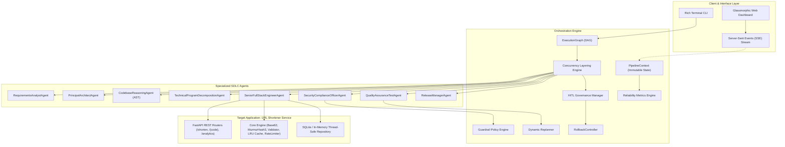
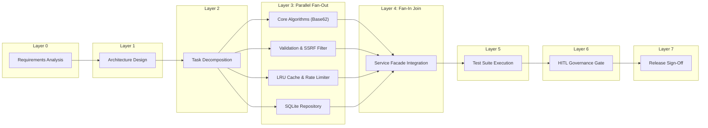

# Architectural Specification: AetherSDLC
## Agentic Software Engineering Orchestration System

---

## 1. System Vision & Core Principles
Modern AI coding tools often suffer from the "unconstrained agent" problem: linear task chaining without state awareness, lack of rollback mechanisms, blind modifications to legacy systems, and absence of audit-grade decision lineage. 

**AetherSDLC** solves this through **Controlled Autonomy**:
1. **Explicit State Machines over Unbounded Prompts**: Execution is governed by an explicit Directed Acyclic Graph (DAG) with hard entry and exit gates.
2. **Governance by Policy Guardrails**: Automated static analysis inspects security (OWASP), compliance (GDPR), and change control (backwards compatibility) before code can progress.
3. **Humans as the Quality & Risk Firewall**: High-impact operations (database schema modifications, public API revisions, release readiness) pause for explicit Human-in-the-Loop (HITL) sign-off.
4. **Resilient Self-Healing with Safe-Stop**: Failures in unit tests or guardrails trigger targeted dynamic re-planning of minimal subgraphs with bounded retries (max 3), followed by deterministic file snapshot rollbacks if unrecoverable.

---

## 2. High-Level System Architecture



---

## 3. Orchestration Engine Architecture

### 3.1 Explicit Dependency Graph (DAG) & Concurrency Layering
The system models SDLC phases not as a simple array of steps, but as a formal Directed Acyclic Graph (`ExecutionGraph` using `networkx`).

- **Entry Gates**: Evaluates pre-conditions before a node executes. For instance, the Architecture node cannot begin until `requirements_srs` artifact exists and passes schema validation.
- **Exit Gates**: Evaluates post-conditions before marking the node completed.
- **Topological Concurrency Layering**: Nodes with in-degree 0 run in Layer 0. Successors whose dependencies are fully satisfied run in Layer 1. Nodes within the same layer that have `allow_parallel=True` execute simultaneously via `asyncio.gather`.
- **Synchronization Barriers (Fan-In)**: Downstream nodes (such as Service Integration or Integration Testing) serve as synchronization points, waiting for all upstream parallel tasks to finish before unblocking.



### 3.2 Dynamic Re-Planning & Self-Healing Feedback Loop
When a verification task fails (e.g. Unit test assertion failure or security SAST rejection):
1. The engine catches the failure and calls `DynamicReplanner.plan_recovery(...)`.
2. The replanner does **NOT** restart the entire pipeline. It inspects the DAG ancestors and isolates the minimal repair subgraph:
   $$\text{Repair Subgraph} = \{\text{CoderAgent}, \text{SecurityAgent}, \text{TestAgent}\}$$
3. It decrements the bounded retry budget (`max_retries = 3`).
4. It injects a detailed diagnostic feedback prompt containing the failing assertion trace.
5. If the retry budget is exhausted, it aborts further execution, triggers `RollbackController.trigger_safe_stop(...)`, and restores the pre-execution snapshot.

### 3.3 Human-in-the-Loop (HITL) Checkpoints
For high-impact architectural moments:
- **Schema Evolution Sign-off**: When database columns or tables are added or modified.
- **Public API Contract Changes**: When request/response payloads or endpoints are updated.
- **Production Release Sign-off**: Final human gate before deployment manifest compilation.

The engine pauses node execution in `TaskStatus.WAITING_APPROVAL`, broadcasts an SSE event to the Web Dashboard, and waits asynchronously (`asyncio.Event`). The human reviewer inspects the proposed diff and risk level, clicking **Approve** (resumes pipeline) or **Reject** (triggers instant filesystem rollback).

### 3.4 Enterprise Policy Guardrails Engine
The `GuardrailEngine` applies static code inspection rules before code is accepted:
- **`SEC-001` (Secret Detection)**: Regex scanning for AWS access keys, GitHub tokens, and hardcoded private keys.
- **`SEC-002` (SQL Injection Prevention)**: AST and pattern detection prohibiting raw string formatting in SQL queries (e.g. `cursor.execute(f"SELECT ...")`). Parameterized queries are mandatory.
- **`SEC-003` (SSRF & Loop Prevention)**: Verifies that destination URLs block loopback addresses (`127.0.0.1`, `localhost`), cloud metadata endpoints (`169.254.169.254`), and self-referencing redirect domains.
- **`COMP-001` (GDPR Compliance)**: Prohibits plaintext client IP persistence in analytics tables. Demands SHA-256 salted hashing with rotating system salt.
- **`REL-001` (Cyclomatic Complexity)**: AST node traversal counting decision branches. Flags functions exceeding complexity threshold of 15.

### 3.5 Rollback & Safe-Stop Controller
Before any code-writing task begins, `RollbackController` captures a file state snapshot (`FileCheckpoint`) of all tracked files. If tests fail repeatedly or a human rejects a gate:
- The controller iterates over tracked files, restoring previous contents and deleting newly created files.
- Marks pipeline state as `TaskStatus.ROLLED_BACK`.
- Guarantees zero partial-write corruption in the repository.

---

## 4. Target Application Architecture: Enterprise URL Shortener

### 4.1 Component Breakdown
The target URL shortener service demonstrates production-grade modularity:
- **`encoder.py`**: Base62 alphabet conversion over 64-bit MurmurHash3 integer hashes. Supports deterministic salt probing (`probe_attempt = 1..50`) upon hash collision.
- **`validator.py`**: RFC 3986 validation, IPv4/IPv6 private subnet checks, cloud metadata filtering, reserved alias blacklist (`api`, `docs`, `health`, `admin`), and loopback prevention.
- **`cache.py`**: Thread-safe `LRUTTLCache` with double-ended queue ordering, lock-guarded eviction, and time-to-live invalidation.
- **`rate_limiter.py`**: Thread-safe `SlidingWindowRateLimiter` maintaining per-client timestamp deques. Enforces 60 write req/min and 1200 read req/min, returning `Retry-After` headers on 429 Too Many Requests.
- **`memory_sqlite.py`**: Thread-safe SQLite repository with WAL mode, parameterized queries, and composite index optimization for fast redirects and analytics aggregations.
- **`service.py`**: Unified facade coordinating cache hits, persistence fallback, click recording, and UTM parameter extraction.
- **`app.py`**: FastAPI application embedding rate-limiting middleware, CORS, and REST router mounts.

---

## 5. Decision Lineage & Observability Schema

Every event is recorded in an immutable ledger conforming to enterprise financial compliance:

```json
{
  "event_id": "9d8b74c2-6712-4f3a-9e12-8e01bf23a456",
  "timestamp": 1729532800.12,
  "pipeline_id": "84c803d7-4c28-44fb-8ea1-6bc22f2541a0",
  "node_id": "ARCH-01",
  "phase": "architecture",
  "agent_name": "PrincipalArchitectAgent",
  "level": "INFO",
  "action": "AGENT_COMPLETED",
  "message": "Agent PrincipalArchitectAgent completed node ARCH-01 in 2.4ms",
  "duration_ms": 2.4,
  "metadata": {
    "output_keys": ["adrs_created", "components_defined", "api_endpoints_count"]
  }
}
```

Reliability telemetry metrics are maintained in real-time:
$$\text{Success Rate} = \frac{\text{Successful Runs}}{\text{Total Runs}} \times 100\%$$
$$\text{MTTR} = \frac{\sum (\text{Recovery Timestamp} - \text{Failure Timestamp})}{\text{Total Re-planning Events}}$$
