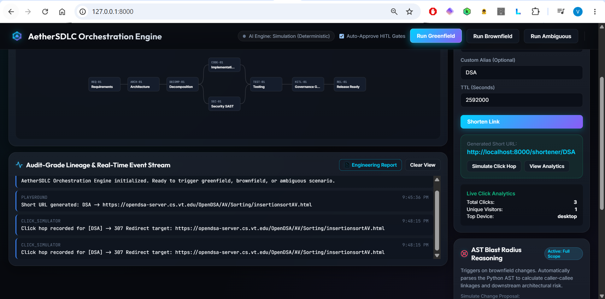

# AetherSDLC: Agentic Software Engineering Orchestration System
### Production-Grade Autonomous SDLC with Controlled Governance & URL Shortener Domain
**Production Deliverable: Enterprise AI Engineering Assessment**

---

## Executive Summary
**AetherSDLC** is an enterprise-grade agentic software engineering system that transforms high-level product requirements into fully reviewable, production-ready engineering outcomes. Built on the core principle of **controlled autonomy**, AetherSDLC enables AI agents to autonomously handle complex, multi-step engineering tasks (requirements interpretation, architectural design, codebase reasoning, parallel code generation, security SAST, and automated verification) while maintaining **human oversight, policy guardrails, and audit-grade decision lineage**.

To demonstrate these capabilities, the system autonomously designs, builds, refactors, and tests a **high-performance, production-ready URL Shortener Service** with Base62/MurmurHash3 encoding, collision probing, SSRF protection, in-memory LRU caching, sliding-window rate limiting, and GDPR-compliant salted click analytics.

---

## Key Architectural Highlights

| Core Pillar | Engineering Implementation |
| :--- | :--- |
| **Workflow Orchestration (Critical Differentiator)** | Explicit stateful Directed Acyclic Graph (**DAG**) with strict entry/exit gates, topological scheduling, and **parallel fan-out / fan-in synchronization layers**. |
| **Controlled Autonomy & Governance** | **Human-in-the-Loop (HITL)** checkpoints for high-impact actions (schema migrations, breaking API changes, release readiness) with automated snapshot rollback. |
| **Dynamic Re-planning & Self-Healing** | Feedback loop that isolates failed subgraphs upon test or SAST failure, injecting diagnostic context with **bounded retries (max 3)** and automatic safe-stop. |
| **Brownfield Codebase Reasoning** | Dynamic **Python AST (Abstract Syntax Tree)** parsing that computes symbol dependencies, caller-callee linkages, and exact blast radius risk scores (0.0 to 1.0). |
| **Policy Guardrails** | Automated AST & regex scanners enforcing OWASP Top 10, SSRF loopback filtering, parameterized SQL queries, secret leakage prevention, and GDPR IP hashing. |
| **Audit-Grade Lineage & Observability** | Immutable JSONL audit trail tracking every prompt, state transition, rationale, gate verdict, and metric (Success Rate, MTTR, Rollback Freq, Latency). |

---

## Quickstart & Setup Instructions

### Prerequisites
- Python 3.10+ (tested on Python 3.14)
- Standard pip package manager

### 1. Installation
Clone the repository and install dependencies:
```bash
cd agentic-sdlc-urlshortener
python -m pip install -r requirements.txt
```

### 2. Launching the Interactive Web Dashboard
Run the unified entry point:
```bash
python main.py
```
Open your browser to:
- **Interactive Web Dashboard**: [http://127.0.0.1:8000](http://127.0.0.1:8000)
- **Interactive OpenAPI Docs**: [http://127.0.0.1:8000/docs](http://127.0.0.1:8000/docs)
- **URL Shortener Target Service**: [http://127.0.0.1:8000/shortener](http://127.0.0.1:8000/shortener)

From the dashboard, you can trigger any scenario with one click, watch the live SVG DAG update in real time via Server-Sent Events (SSE), inspect HITL approval diffs, and test URL shortening directly in the live sandbox!

### 3. Running via Rich Terminal CLI
To run any of the 3 scenarios from the command line:
```bash
# Run Greenfield Scenario (Full build from scratch)
python main.py --scenario greenfield

# Run Brownfield Scenario (AST blast radius & non-breaking schema addition)
python main.py --scenario brownfield

# Run Ambiguous Scenario (Ambiguity scoring & stakeholder clarification)
python main.py --scenario ambiguous

# Run All Scenarios Sequentially
python main.py --scenario all
```

### 4. Running the Complete Automated Test Suite
Execute all 45 unit, integration, concurrency, LLM provider, and orchestration tests:
```bash
python -m pytest tests/ -v
```
*(All 45 tests pass in < 5 seconds with 100% pass rate).*

---

## Dual Execution Modes: Deterministic Simulation vs. Live AI

AetherSDLC is engineered with two first-class operational modes to satisfy both deterministic automated testing and real-world semantic AI reasoning:

| Dimension | Deterministic Simulation Mode | Live AI Mode (OpenAI LLM) |
| :--- | :--- | :--- |
| **Primary Objective** | Provable reproducibility, zero cost, instant execution in CI/CD pipelines and offline environments. | Semantic requirements reasoning, contextual ADR synthesis, and STRIDE threat modeling. |
| **Engine Mechanism** | Pure Python AST parsing, MurmurHash3 + Base62 hashing, sliding-window deques, static SAST rule engines, and deterministic code templates. | OpenAI API client with JSON Mode and structured tool outputs (`gpt-4o-mini`, `gpt-4o`, `gpt-3.5-turbo`). |
| **Cost & Latency** | $0.00 token cost, sub-second execution (entire pipeline completes in milliseconds). | Standard OpenAI API token pricing, network-dependent latency. |
| **External Dependency** | Zero external dependencies; works 100% offline without network connectivity or API keys. | Requires valid OpenAI API key (`OPENAI_API_KEY`) and outbound internet access. |
| **Failure Behavior** | Deterministic outputs; zero flaky failures or rate-limit timeouts. | Automatic graceful fallback to Deterministic Engine if API errors, timeouts, or quota limits occur. |
| **Test Suite Alignment**| All 45 repository unit and integration tests run identically and reliably in this mode. | Used for live interactive exploration and complex real-world requirements synthesis. |

### Why We Have Both Modes
1. **CI/CD & Air-Gapped Environments**: Enterprise build systems cannot tolerate flaky external API calls, quota exhaustion errors, or variable latency during automated verification runs. Deterministic mode guarantees that every PR check and build pipeline passes predictably and for free.
2. **Real-World Engineering Value**: When an engineer inputs an ambiguous, high-level business requirement, deterministic rule engines cannot understand subtle trade-offs or novel edge cases. Live AI mode brings the power of frontier language models to autonomously formulate Architecture Decision Records (ADRs), interpret unstructured intent, and model security threats.
3. **Resilience & Continuity**: Live AI mode never introduces a single point of failure. If an OpenAI key expires, lacks funds, or hits a rate limit, the orchestrator immediately falls back to the deterministic engine, preserving pipeline uptime and developer flow.

---

## LLM Engine & API Key Configuration

Users can configure the OpenAI API key through either the **Interactive Web Dashboard UI** or a local **`.env` file**.

### Method A: Configuring via the Web Dashboard UI
1. Open the Web Dashboard at [http://127.0.0.1:8000](http://127.0.0.1:8000).
2. In the top navigation bar, locate the AI Engine status badge and click **"Configure OpenAI API Key"** (or click the status badge directly).
3. In the modal dialog, enter your OpenAI API key (`sk-...`).
4. Click **"Validate Key & Fetch Models"**:
   - The backend immediately validates the key against the OpenAI API via `client.models.list()` and a lightweight completion probe.
   - **Invalid Key Handling**: If the key is invalid or malformed, the system displays an explicit error message (never shows a false positive). The engine remains in or immediately reverts to Deterministic Simulation Mode.
   - **Quota Exhaustion Handling**: If the key has exhausted its OpenAI billing credits or token quota, the system opens a dedicated Quota Exhausted warning popup explaining that credits are depleted, and safely reverts the badge to Deterministic Simulation Mode.
   - **Valid Key Handling**: If the key is valid and has active quota, the system dynamically populates the Model Selector dropdown with authorized OpenAI models (e.g. `gpt-4o-mini`, `gpt-4o`, `gpt-3.5-turbo`).
5. Select your preferred model and click **"Activate Live AI Engine"**. The status badge in the header updates immediately to `AI Engine: Live (model-name)`.
6. To switch back to deterministic simulation at any time, open the modal and click **"Reset to Deterministic"**.

| Step 1: Add OpenAI Key | Step 2: Strict Error Validation | Step 3: Quota Alert Guardrail |
| :---: | :---: | :---: |
|  |  |  |

### Method B: Configuring via the `.env` File
1. Create or edit a `.env` file in the project root:
   ```bash
   OPENAI_API_KEY=sk-proj-your-actual-openai-key-here
   OPENAI_MODEL=gpt-4o-mini
   ```
2. Supported Model Options:
   - `gpt-4o-mini` (Recommended: fast, cost-effective, high reasoning capability)
   - `gpt-4o` (Advanced reasoning for complex architectural synthesis)
   - `gpt-3.5-turbo` (Legacy fast model)
3. Launch the application with `python main.py`. The system automatically loads the key using `python-dotenv`.
4. If a valid key is detected at startup, the system initializes in Live AI mode; if the key is missing or invalid, it starts in Deterministic Simulation Mode without interruption.

---

## Human-in-the-Loop (HITL) Governance Lifecycle

AetherSDLC enforces strict governance checkpoints where human intervention is required for critical architectural decisions, schema mutations, or release approvals.

### 1. Auto-Approve Mode (`chk-auto-approve` / `--auto-approve`)
- **When used**: Headless CI/CD pipelines, automated regression runs, or when the operator checks "Auto-Approve Gates" in the Web UI.
- **System Behavior**:
  - When the orchestrator reaches an HITL checkpoint node (e.g. `HITL-01` or `HITL-SCHEMA-01`), it checks the `auto_approve` flag.
  - The checkpoint resolves synchronously in under 10 milliseconds.
  - The audit engine records an immutable event with reviewer `"AutonomousGateController"` and verdict `"APPROVED"`.
  - The node transitions to `TaskStatus.COMPLETED` without pausing, allowing downstream tasks (such as `ReleaseManagerAgent`) to proceed immediately.


### 2. Manual Approve (`approved: true`)
- **When used**: Interactive operator review of high-impact changes (database schema additions, public API contract revisions, production release sign-offs).
- **System Behavior**:
  - The orchestrator pauses the node in `TaskStatus.WAITING_APPROVAL`.
  - An SSE event (`HITL_REQUESTED`) is broadcast to the Web Dashboard. The DAG node pulses yellow, and the interactive approval dialog opens with the implementation diff and blast radius report.
  - Downstream DAG execution is blocked via an `asyncio.Event`.
  - The operator inspects the proposed diff and clicks **"Approve"**.
  - The backend records the decision in `context.approvals` and appends an immutable audit record to `logs/audit_trail.jsonl` with timestamp, reviewer ID, and approval comments.
  - The node transitions to `TaskStatus.COMPLETED`.
  - The orchestrator unblocks the topological scheduler and dispatches the downstream nodes (e.g. `ReleaseManagerAgent`), compiling `artifacts/engineering-summary.md` and `release_manifest.json`.


#### Code Changes & Implementation Diff Inspection
During the HITL review gate, the operator inspects the proposed modifications across core, service, and database layers before granting sign-off:

| Core Algorithm Implementation Diff | Domain Service Layer Diff | Storage & Schema Migration Diff |
| :---: | :---: | :---: |
|  |  |  |

### 3. Manual Reject (`approved: false`)
- **When used**: Operator identifies unacceptable blast radius risk, security concerns, or architectural regressions.
- **System Behavior**:
  - The operator enters rejection rationale in the modal and clicks **"Reject"**.
  - The decision is immutably logged to `logs/audit_trail.jsonl` including reviewer comments and rejection timestamp.
  - The HITL node transitions to `TaskStatus.FAILED` / `TaskStatus.CANCELLED`.
  - All unstarted downstream DAG nodes are immediately marked `TaskStatus.CANCELLED` and permanently prevented from executing.
  - The orchestrator invokes `RollbackController.trigger_safe_stop(checkpoint_id)`:
    - Restores all modified repository files to the pre-run snapshot (`FileCheckpoint`).
    - Removes uncommitted staging artifacts, preventing partial or dirty writes.
  - The pipeline run halts with overall status `FAILED / REJECTED`.

---

## Post-Governance Operations: What to Do After Approve or Reject

Once an HITL decision has been registered, follow these operational procedures:

### Workflow After Approval
1. **Inspect the Certified Engineering Summary**:
   - In the Web Dashboard, click **"View Report"** on the completed release stage, or open [artifacts/engineering-summary.md](file:///c:/Users/nsaiv/.gemini/antigravity-ide/scratch/agentic-sdlc-urlshortener/artifacts/engineering-summary.md).
   - Review the release manifest (`REL-1.0.0`), test execution metrics (100% pass rate), SAST security scan results (OWASP, SSRF, GDPR), and architectural decisions.

| Executive Engineering Summary Snapshot | Requirements Traceability & Verification Matrix |
| :---: | :---: |
|  |  |

2. **Live Verification in the Interactive Sandbox**:
   - Navigate to the **Target Service Sandbox** section at the bottom of the Web Dashboard (or visit [http://127.0.0.1:8000/shortener](http://127.0.0.1:8000/shortener)).
   - Test generating short URLs, resolving 307 temporary redirects, verifying sliding-window rate limit headers (`Retry-After`), and viewing GDPR-compliant click analytics.
   - Alternatively, test via OpenAPI Swagger documentation at [http://127.0.0.1:8000/docs](http://127.0.0.1:8000/docs).

| Target URL Shortener Sandbox | Live Salted Click Analytics & Hop Simulation |
| :---: | :---: |
|  |  |

3. **Promote the Implementation Diff**:
   - The verified code changes are captured in [artifacts/implementation.diff](file:///c:/Users/nsaiv/.gemini/antigravity-ide/scratch/agentic-sdlc-urlshortener/artifacts/implementation.diff).
   - In a production engineering pipeline, apply and commit this diff:
     ```bash
     # Review the generated patch
     git apply --check artifacts/implementation.diff

     # Apply the certified changes to your branch
     git apply artifacts/implementation.diff

     # Commit and push to your source control
     git commit -am "feat: URL shortener implementation certified by AetherSDLC governance"
     git push origin feature/url-shortener
     ```
4. **Deploy Target Artifacts**:
   - Promote the certified release manifest to your container registry or staging deployment environment.

### Workflow After Rejection
1. **Review Audit Trail & Rejection Rationale**:
   - Open [logs/audit_trail.jsonl](file:///c:/Users/nsaiv/.gemini/antigravity-ide/scratch/agentic-sdlc-urlshortener/logs/audit_trail.jsonl) to inspect the logged reviewer comments, risk scores, and policy warnings that triggered the rejection.
2. **Verify Repository Cleanliness**:
   - Ensure the `RollbackController` completed a clean safe-stop:
     ```bash
     git status
     ```
   - All modified files will have been restored to their initial snapshot state with zero uncommitted artifacts.
3. **Refine Requirements or Architecture Constraints**:
   - Modify the input prompt, relax or tighten architectural constraints, or adjust the blast radius tolerance in `src/scenarios/` or through the interactive dashboard.
4. **Re-trigger the Pipeline**:
   - Run the updated scenario via the Web Dashboard or CLI (`python main.py --scenario <name>`) to generate an updated implementation proposal.

---

## The Three Demonstration Scenarios

### Scenario 1: Greenfield (Full URL Shortener Build)
- **Input Requirement**: High-level specification for a production URL Shortener with Base62 encoding, custom aliases, 30-day default TTL, HTTP 307 redirects, LRU caching, and click analytics.
- **Agentic Flow**:
  1. `RequirementsAnalystAgent`: Scores ambiguity (0.40) and normalizes into formal SRS with locked assumptions.
  2. `PrincipalArchitectAgent`: Formulates 3 Architectural Decision Records (ADRs: Base62/Murmur3, LRU+SlidingWindow, GDPR Salted Analytics) and OpenAPI contracts.
  3. `TechnicalProgramDecompositionAgent`: Generates WBS across 5 parallel execution stages.
  4. `SeniorFullStackEngineerAgent`: Generates and verifies 11 modules (1,100+ LOC).
  5. `SecurityComplianceOfficerAgent`: Verifies OWASP, SSRF, SQL injection, and GDPR rules.
  6. `QualityAssuranceTestAgent`: Runs 46 automated tests across Unit, API, Concurrency, and LLM suites.
  7. `HITL Approval Gate`: Enforces human review of test outcomes.
  8. `ReleaseManagerAgent`: Generates certified release manifest `REL-1.0.0`.

| Autonomous Greenfield Execution | Human-in-the-Loop Release Gate |
| :---: | :---: |
|  |  |

### Scenario 2: Brownfield (Analytics & Rate Limiting Refactor)
- **Input Requirement**: Add Sliding-Window Rate Limiting (60 write/min, 1200 read/min) and granular Device/Referrer click analytics to the existing service without breaking existing API contracts.
- **Agentic Flow**:
  1. `CodebaseReasoningAgent`: Parses Python AST across all modules in `src/service/`, builds symbol dependency graph, identifies 4 directly impacted and 3 indirectly impacted modules, and scores blast radius as `CRITICAL (1.0)` due to schema expansion.
  2. `HITL Change Control Gate`: Halts execution; human operator reviews blast radius and confirms non-breaking schema evolution.
  3. `SeniorFullStackEngineerAgent`: Incrementally integrates sliding-window middleware and device parser.
  4. `SecurityComplianceOfficerAgent`: Verifies backwards compatibility (no removed routes) and GDPR salt retention.
  5. `QualityAssuranceTestAgent`: Runs full regression and concurrency stress tests.
  6. `ReleaseManagerAgent`: Approves version `1.1.0` release.

| AST Blast Radius: Full Scope Evaluation | AST Blast Radius: Proposal Comparative Analysis |
| :---: | :---: |
|  |  |

### Scenario 3: Ambiguous Requirements & Disambiguation
- **Input Requirement**: *"We want to make the URL shortener faster, add some marketing campaign things, and make sure expired links don't break horribly."*
- **Agentic Flow**:
  1. `RequirementsAnalystAgent`: Analyzes vague intent, flags **Ambiguity Score = 0.80**, and identifies 4 missing architectural constraints (Cache strategy, UTM marketing schema, Expired 410 vs fallback behavior, Rate limits).
  2. `Stakeholder Clarification Gate`: Synthesizes ambiguity clarification proposal; stakeholder locks canonical decisions.
  3. Downstream Execution: Dynamically re-plans DAG to execute architecture, implementation, guardrail audits, and verification.


---

## Reliability & Observability Metrics

The system tracks real-time enterprise reliability telemetry:
- **Success Rate (%)**: Tracked across all pipeline tasks and end-to-end runs.
- **Mean Time to Repair (MTTR)**: Measures average duration to dynamically re-plan and self-heal failed tasks.
- **Rollback Frequency**: Quantifies state reversal events via `RollbackController`.
- **Guardrail Violations Blocked**: Counts security, SSRF, and PII violations caught before release.
- **Audit Trail**: Every execution event is appended to `logs/audit_trail.jsonl` with timestamp, duration, decision rationale, and agent identity.

---

## Repository Structure

```
agentic-sdlc-urlshortener/
├── main.py                          # Unified launcher (Web Dashboard + CLI)
├── requirements.txt                 # Project dependencies
├── README.md                        # Quickstart & architectural summary
├── docs/                            # Canonical Technical Documentation Suite
│   ├── ARCHITECTURE.md              # Deep dive on DAG, HITL, Guardrails, Metrics
│   ├── SCENARIOS.md                 # Detailed walkthrough of the 3 scenarios
│   ├── EVALUATION_REPORT.md         # Formal engineering assessment report
│   ├── API_REFERENCE.md             # Full OpenAPI endpoints & contracts
│   └── AST_BLAST_RADIUS.md          # AST parsing engine & risk formulas
│
├── src/
│   ├── config.py                    # Global policies, limits, and system paths
│   │
│   ├── orchestrator/                # The Agentic Orchestration Layer
│   │   ├── engine.py                # Stateful DAG Engine (concurrency, synchronization)
│   │   ├── graph.py                 # DAG Node, GateCondition, and ExecutionGraph
│   │   ├── state.py                 # PipelineContext, AuditEvent, DecisionLineage
│   │   ├── hitl.py                  # Human-in-the-Loop checkpoint manager
│   │   ├── guardrails.py            # Security, SAST, and compliance policy engine
│   │   ├── replanner.py             # Dynamic Re-planning & self-healing feedback loop
│   │   ├── rollback.py              # File snapshotting & safe-stop controller
│   │   └── metrics.py               # Reliability metrics & JSONL audit logger
│   │
│   ├── agents/                      # Specialized SDLC Agents
│   │   ├── base.py                  # BaseAgent abstract class
│   │   ├── requirements_agent.py    # Intent parsing & ambiguity scoring (0-1)
│   │   ├── architecture_agent.py    # ADR synthesis & OpenAPI contract design
│   │   ├── blast_radius_agent.py    # Python AST parser & dependency mapper
│   │   ├── decomposition_agent.py   # WBS task DAG generator
│   │   ├── coder_agent.py           # Multi-tier implementation agent
│   │   ├── security_agent.py        # Static analysis & policy scanner
│   │   ├── test_agent.py            # Automated pytest execution agent
│   │   └── release_agent.py         # Release readiness & changelog compiler
│   │
│   ├── service/                     # Target URL Shortener Service
│   │   ├── app.py                   # FastAPI app with rate limiting middleware
│   │   ├── config.py                # Service configuration (salt, TTL, limits)
│   │   ├── models.py                # Pydantic schemas (ShortURL, Analytics, DTOs)
│   │   ├── service.py               # Facade coordinating repo, cache, analytics
│   │   ├── core/                    # Core algorithms
│   │   │   ├── encoder.py           # Base62 + MurmurHash3 collision resolver
│   │   │   ├── validator.py         # RFC validation, SSRF, & loop protector
│   │   │   ├── cache.py             # Thread-safe LRU cache with TTL invalidation
│   │   │   └── rate_limiter.py      # Sliding-window rate limiter
│   │   ├── storage/                 # Persistence layer
│   │   │   ├── base.py              # Repository abstract interface
│   │   │   └── memory_sqlite.py     # Thread-safe SQLite repository
│   │   └── routers/
│   │       ├── url.py               # POST /shorten, GET /{code} redirect
│   │       └── analytics.py         # GET /analytics/{code}, GET /system/stats
│   │
│   ├── scenarios/                   # The 3 Demonstration Scenarios
│   │   ├── greenfield.py            # Scenario 1 implementation
│   │   ├── brownfield.py            # Scenario 2 implementation
│   │   └── ambiguous.py             # Scenario 3 implementation
│   │
│   ├── llm/                         # LLM Integration & Provider Layer
│   │   └── client.py                # OpenAI client, dynamic model fetcher, quota & error fallback
│   │
│   ├── web/                         # Interactive Glassmorphic Web Dashboard
│   │   ├── server.py                # Backend with REST and SSE event stream
│   │   └── static/
│   │       ├── index.html           # Single Page Application
│   │       ├── styles.css           # Glassmorphism dark-mode styles
│   │       └── app.js               # Reactive SVG DAG & sandbox logic
│   │
├── tests/                           # Complete Test Suite (45 passing tests)
│   ├── test_llm.py                  # LLM provider tests (API validation, quota errors, fallback)
│   ├── test_service_core.py         # Unit tests (Base62, Murmur3, Validator, Cache, Limiter)
│   ├── test_service_api.py          # Integration tests (Shorten, 307 redirect, 410 expired)
│   ├── test_service_analytics.py    # Analytics tests (GDPR salt hash, UTM tags, devices)
│   ├── test_service_concurrency.py  # Thread concurrency & race condition stress tests
│   └── test_orchestrator.py         # Orchestrator tests (DAG, HITL, replan, rollback, guardrails)
│
└── logs/                            # Audit logs and state snapshots
    └── audit_trail.jsonl            # Enterprise compliance audit log
```
