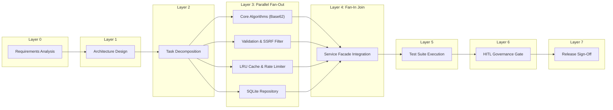
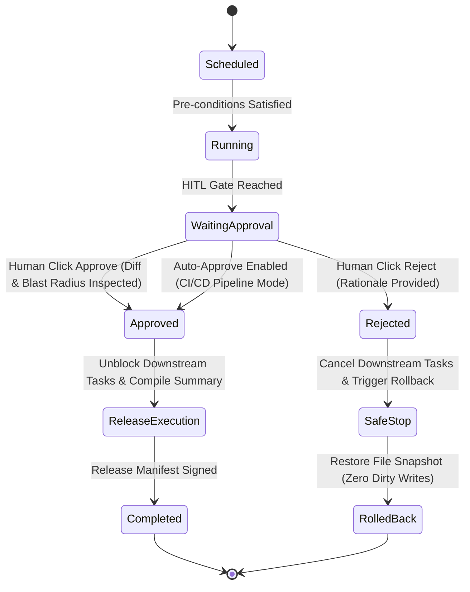

# Architectural Specification: AetherSDLC
## Agentic Software Engineering Orchestration System

---

## 1. System Vision & Core Principles
Modern AI coding tools often suffer from the "unconstrained agent" problem: linear task chaining without state awareness, lack of rollback mechanisms, blind modifications to legacy systems, and absence of audit-grade decision lineage. 

**AetherSDLC** solves this through **Controlled Autonomy**:
1. **Explicit State Machines over Unbounded Prompts**: Execution is governed by an explicit Directed Acyclic Graph (DAG) with hard entry and exit gates.
2. **Governance by Policy Guardrails**: Automated static analysis inspects security (OWASP), compliance (GDPR), and change control (backwards compatibility) before code can progress.
3. **Humans as the Quality & Risk Firewall**: High-impact operations (database schema modifications, public API revisions, release readiness) pause for explicit Human-in-the-Loop (HITL) sign-off.
4. **Resilient Self-Healing with Safe-Stop**: Failures in unit tests or guardrails trigger targeted dynamic re-planning of minimal subgraphs with bounded retries (max 3), followed by deterministic file snapshot rollbacks if unrecoverable.

---

## 2. High-Level System Architecture

```mermaid
graph TD
    subgraph Client & Interface Layer
        CLI["Rich Terminal CLI"]
        WEB["Glassmorphic Web Dashboard"]
        SSE["Server-Sent Events (SSE) Stream"]
    end

    subgraph Intelligence & AI Engine Layer
        DETERM["Deterministic Simulation Engine (AST, Rules, Templates, $0.00)"]
        LLM["LLMClient Provider Layer (OpenAI gpt-4o-mini, gpt-4o, gpt-3.5)"]
        KEYVAL["Key Validator & Quota Monitor (models.list probe)"]
        FALLBACK["Automatic Graceful Fallback Handler"]
        KEYVAL --> LLM
        LLM -.->|On 400/429/Network Error| FALLBACK
        FALLBACK --> DETERM
    end

    subgraph Orchestration Engine
        DAG["ExecutionGraph (DAG)"]
        LAYERS["Concurrency Layering Engine"]
        CTX["PipelineContext (Immutable State)"]
        HITL["HITL Governance Manager"]
        GUARD["Guardrail Policy Engine"]
        REPLAN["Dynamic Replanner"]
        ROLLBACK["RollbackController"]
        METRICS["Reliability Metrics Engine"]
    end

    subgraph Specialized SDLC Agents
        REQ["RequirementsAnalystAgent"]
        ARCH["PrincipalArchitectAgent"]
        BLAST["CodebaseReasoningAgent (AST)"]
        DECOMP["TechnicalProgramDecompositionAgent"]
        CODER["SeniorFullStackEngineerAgent"]
        SEC["SecurityComplianceOfficerAgent"]
        QA["QualityAssuranceTestAgent"]
        REL["ReleaseManagerAgent"]
    end

    subgraph Target Application: URL Shortener Service
        ROUTERS["FastAPI REST Routers (/shorten, /{code}, /analytics)"]
        CORE["Core Engine (Base62, MurmurHash3, Validator, LRU Cache, RateLimiter)"]
        STORE["SQLite / In-Memory Thread-Safe Repository"]
    end

    CLI --> DAG
    WEB --> SSE
    WEB --> KEYVAL
    SSE -.-> CTX
    DAG --> LAYERS
    LAYERS --> REQ
    LAYERS --> ARCH
    LAYERS --> BLAST
    LAYERS --> DECOMP
    LAYERS --> CODER
    LAYERS --> SEC
    LAYERS --> QA
    LAYERS --> HITL
    LAYERS --> REL
    REQ -.-> LLM
    ARCH -.-> LLM
    SEC -.-> LLM
    REL -.-> LLM
    REQ -.-> DETERM
    ARCH -.-> DETERM
    SEC -.-> DETERM
    REL -.-> DETERM
    CODER --> ROUTERS
    CODER --> CORE
    CODER --> STORE
    SEC --> GUARD
    QA --> REPLAN
    HITL --> ROLLBACK
    CTX --> METRICS
```



---

## 3. Orchestration Engine Architecture

### 3.1 Explicit Dependency Graph (DAG) & Concurrency Layering
The system models SDLC phases not as a simple array of steps, but as a formal Directed Acyclic Graph (`ExecutionGraph` using `networkx`).

- **Entry Gates**: Evaluates pre-conditions before a node executes. For instance, the Architecture node cannot begin until `requirements_srs` artifact exists and passes schema validation.
- **Exit Gates**: Evaluates post-conditions before marking the node completed.
- **Topological Concurrency Layering**: Nodes with in-degree 0 run in Layer 0. Successors whose dependencies are fully satisfied run in Layer 1. Nodes within the same layer that have `allow_parallel=True` execute simultaneously via `asyncio.gather`.
- **Synchronization Barriers (Fan-In)**: Downstream nodes (such as Service Integration or Integration Testing) serve as synchronization points, waiting for all upstream parallel tasks to finish before unblocking.



### 3.2 Dynamic Re-Planning & Self-Healing Feedback Loop
When a verification task fails (e.g. Unit test assertion failure or security SAST rejection):
1. The engine catches the failure and calls `DynamicReplanner.plan_recovery(...)`.
2. The replanner does **NOT** restart the entire pipeline. It inspects the DAG ancestors and isolates the minimal repair subgraph:
   $$\text{Repair Subgraph} = \{\text{CoderAgent}, \text{SecurityAgent}, \text{TestAgent}\}$$
3. It decrements the bounded retry budget (`max_retries = 3`).
4. It injects a detailed diagnostic feedback prompt containing the failing assertion trace.
5. If the retry budget is exhausted, it aborts further execution, triggers `RollbackController.trigger_safe_stop(...)`, and restores the pre-execution snapshot.

### 3.3 Human-in-the-Loop (HITL) Governance Lifecycle & State Machine
AetherSDLC enforces strict governance gates where autonomous execution safely halts for human verification before high-impact actions occur:
- **Schema Evolution Sign-off**: When database columns or tables are added or modified (e.g. adding `click_events` table).
- **Public API Contract Changes**: When request/response payloads or endpoints are updated.
- **Production Release Sign-off**: Final human gate before deployment manifest compilation.

#### HITL State Machine Transitions


#### Governance Decision Behaviors
1. **Auto-Approve (`chk-auto-approve: true` / `--auto-approve`)**:
   - Designed for headless CI/CD pipelines, automated regression suites, and rapid integration testing.
   - The orchestrator detects `auto_approve=True` upon reaching an HITL gate node.
   - Resolves synchronously in milliseconds without blocking.
   - Emits an audit event with reviewer `"AutonomousGateController"` and verdict `"APPROVED"`.
   - Node status transitions immediately to `TaskStatus.COMPLETED`, unblocking downstream tasks.

2. **Manual Approve (`approved: true`)**:
   - Checkpoint pauses node execution in `TaskStatus.WAITING_APPROVAL`.
   - Broadcasts an SSE event (`HITL_REQUESTED`) to the Web Dashboard. The DAG node pulses yellow, and the interactive approval dialog opens with the implementation diff and blast radius report.
   - An `asyncio.Event` blocks downstream topological scheduling.
   - When the operator clicks **Approve**:
     - The backend records decision lineage in `PipelineContext.approvals`.
     - An immutable audit record is appended to `logs/audit_trail.jsonl` with timestamp, reviewer ID, and approval comments.
     - Node transitions to `TaskStatus.COMPLETED`.
     - The `asyncio.Event` sets, unblocking downstream tasks (e.g. `ReleaseManagerAgent`), which generates `artifacts/engineering-summary.md` and `release_manifest.json`.

3. **Manual Reject (`approved: false`)**:
   - The operator enters rejection rationale in the modal dialog and clicks **Reject**.
   - An immutable audit record is appended to `logs/audit_trail.jsonl` with reviewer ID, timestamp, and rejection rationale.
   - The HITL node transitions to `TaskStatus.FAILED` / `TaskStatus.CANCELLED`.
   - All unstarted downstream DAG nodes are immediately marked `TaskStatus.CANCELLED` and prevented from running.
   - The orchestrator invokes `RollbackController.trigger_safe_stop(checkpoint_id)`:
     - Restores all modified repository files to the pre-run snapshot (`FileCheckpoint`).
     - Cleans up temporary artifacts, guaranteeing zero partial-write corruption in the repository.
   - Pipeline halts with status `FAILED / REJECTED`.

---

### 3.4 Post-Governance Operations & Promotion Runbook

#### Post-Approval Operations (Next Steps for Operator/CI)
1. **Inspect Certified Engineering Summary**:
   - In the Web Dashboard, click **"View Report"** on the completed release stage, or open [artifacts/engineering-summary.md](file:///c:/Users/nsaiv/.gemini/antigravity-ide/scratch/agentic-sdlc-urlshortener/artifacts/engineering-summary.md).
   - Review release ID (`REL-1.0.0`), test execution metrics (100% pass rate), SAST security scan results (OWASP, SSRF, GDPR), and architectural decisions.
2. **Live Functional Testing in the Sandbox**:
   - Navigate to the **Target Service Sandbox** section at the bottom of the Web Dashboard (or visit [http://127.0.0.1:8000/shortener](http://127.0.0.1:8000/shortener)).
   - Test generating short URLs, resolving 307 temporary redirects, verifying sliding-window rate limit headers (`Retry-After`), and viewing GDPR-compliant click analytics.
   - Alternatively, test via OpenAPI Swagger documentation at [http://127.0.0.1:8000/docs](http://127.0.0.1:8000/docs).
3. **Promote the Implementation Diff**:
   - The verified code changes are captured in [artifacts/implementation.diff](file:///c:/Users/nsaiv/.gemini/antigravity-ide/scratch/agentic-sdlc-urlshortener/artifacts/implementation.diff).
   - In a production engineering pipeline, apply and commit this diff:
     ```bash
     # Review the generated patch
     git apply --check artifacts/implementation.diff

     # Apply the certified changes to your branch
     git apply artifacts/implementation.diff

     # Commit and push to your source control
     git commit -am "feat: URL shortener implementation certified by AetherSDLC governance"
     git push origin feature/url-shortener
     ```
4. **Deploy Target Artifacts**:
   - Promote the certified release manifest to your container registry or staging deployment environment.

#### Post-Rejection Operations (Next Steps for Operator/CI)
1. **Review Audit Trail & Rejection Rationale**:
   - Open [logs/audit_trail.jsonl](file:///c:/Users/nsaiv/.gemini/antigravity-ide/scratch/agentic-sdlc-urlshortener/logs/audit_trail.jsonl) to inspect the logged reviewer comments, risk scores, and policy warnings that triggered the rejection.
2. **Verify Repository Cleanliness**:
   - Ensure the `RollbackController` completed a clean safe-stop:
     ```bash
     git status
     ```
   - All modified files will have been restored to their initial snapshot state with zero uncommitted artifacts.
3. **Refine Requirements or Architecture Constraints**:
   - Modify the input prompt, relax or tighten architectural constraints, or adjust the blast radius tolerance in `src/scenarios/` or through the interactive dashboard.
4. **Re-trigger the Pipeline**:
   - Run the updated scenario via the Web Dashboard or CLI (`python main.py --scenario <name>`) to generate an updated implementation proposal.

---

### 3.5 Enterprise Policy Guardrails Engine
The `GuardrailEngine` applies static code inspection rules before code is accepted:
- **`SEC-001` (Secret Detection)**: Regex scanning for AWS access keys, GitHub tokens, and hardcoded private keys.
- **`SEC-002` (SQL Injection Prevention)**: AST and pattern detection prohibiting raw string formatting in SQL queries (e.g. `cursor.execute(f"SELECT ...")`). Parameterized queries are mandatory.
- **`SEC-003` (SSRF & Loop Prevention)**: Verifies that destination URLs block loopback addresses (`127.0.0.1`, `localhost`), cloud metadata endpoints (`169.254.169.254`), and self-referencing redirect domains.
- **`COMP-001` (GDPR Compliance)**: Prohibits plaintext client IP persistence in analytics tables. Demands SHA-256 salted hashing with rotating system salt.
- **`REL-001` (Cyclomatic Complexity)**: AST node traversal counting decision branches. Flags functions exceeding complexity threshold of 15.

---

### 3.6 Rollback & Safe-Stop Controller
Before any code-writing task begins, `RollbackController` captures a file state snapshot (`FileCheckpoint`) of all tracked files. If tests fail repeatedly or a human rejects a gate:
- The controller iterates over tracked files, restoring previous contents and deleting newly created files.
- Marks pipeline state as `TaskStatus.ROLLED_BACK`.
- Guarantees zero partial-write corruption in the repository.

---

### 3.7 Dual Execution Modes & LLM Provider Architecture
AetherSDLC decouples the agent orchestration logic from the underlying intelligence engine, enabling two distinct execution modes:

```
[Agent Layer] ---> [src/llm/client.py]
                         |
      +------------------+------------------+
      | (If API Key Valid & Quota OK)       | (If Key Missing, Invalid, or 429 Quota)
      v                                     v
[Live OpenAI Client]               [Deterministic Simulation Engine]
- gpt-4o-mini / gpt-4o             - Python AST Codebase Reasoning
- Dynamic Model Fetching           - MurmurHash3 + Base62 Algorithms
- Structured JSON Outputs          - Sliding-Window Token Bucket Deques
- Semantic Ambiguity Resolution    - OWASP AST/Regex Static Scanners
- Threat Modeling (STRIDE)         - 100% Offline / $0.00 Token Cost
```

#### Why We Have Two Modes
1. **Deterministic Simulation Mode (Zero-Cost, Offline, CI/CD)**:
   - **Rationale**: Enterprise build pipelines, integration tests, and air-gapped developer workstations cannot depend on external internet access, API rate limits, or token billing quotas.
   - **Characteristics**: Sub-millisecond execution, zero token cost, 100% reproducible test outcomes across all 45 automated repository tests.
   - **Implementation**: Utilizes Python's native `ast` module, MurmurHash3 hashing, Base62 encoding tables, sliding-window deques, and pre-validated architectural schemas.
2. **Live AI Mode (OpenAI LLM Integration)**:
   - **Rationale**: Real-world software development requires nuanced understanding of vague human intent, semantic disambiguation of edge cases, contextual trade-off evaluation in ADRs, and exploratory threat modeling.
   - **Characteristics**: Connects to OpenAI frontier models (`gpt-4o-mini`, `gpt-4o`, `gpt-3.5-turbo`) using JSON Mode and structured system prompts.
   - **Automatic Resilience**: If an API key expires, an account quota is exhausted (`429`), or network connectivity drops, the client automatically and gracefully reverts to the deterministic simulation engine without terminating the pipeline.

#### Key Validation & Quota Exhaustion Handling
- **Endpoint**: `POST /api/pipeline/validate-llm-key`
- **Validation Pipeline**:
  1. Checks key prefix formatting (`sk-...`).
  2. Queries `client.models.list()` to confirm account authorization and retrieve active models.
  3. Executes a lightweight test completion probe to verify model inference permissions.
- **Error Semantics**:
  - **Invalid Key**: Returns HTTP `400` with code `INVALID_KEY`. The UI explicitly displays an error message (never shows false success), and the engine safely remains in Deterministic mode.
  - **Quota Exhaustion**: Returns HTTP `429` with code `QUOTA_EXHAUSTED`. The UI opens a dedicated Quota Exhausted warning popup modal, and the engine immediately reverts the header badge to `AI Engine: Simulation (Deterministic)`.
  - **Success**: Returns HTTP `200` with an array of authorized OpenAI models, enabling the user to choose their preferred model and activate live AI execution.

#### API Key Configuration Methods
- **Web Dashboard UI**: Click "Configure OpenAI API Key" in the top navigation bar, submit your key, review dynamic models, and activate Live AI with one click.
- **Environment File (`.env`)**: Place `OPENAI_API_KEY=sk-...` and optionally `OPENAI_MODEL=gpt-4o-mini` in the root `.env` file. Automatically detected at startup via `python-dotenv`.

---

### 3.8 Supported Language Models & Agentic Integration Points
When Live AI Mode is active, the system targets these models:
- **`gpt-4o-mini` (Default)**: Optimized for fast response times, high structured JSON reliability, and cost-effective reasoning.
- **`gpt-4o`**: High-reasoning model for complex multi-module architectural trade-offs and comprehensive STRIDE threat modeling.
- **`gpt-3.5-turbo`**: Fast fallback model for lightweight disambiguation.

#### Agent Integration Matrix
| Agent | Live AI Role | Deterministic Fallback Role |
| :--- | :--- | :--- |
| `RequirementsAnalystAgent` | Semantic ambiguity scoring, edge case generation, intent normalization. | Metric-based ambiguity heuristic (0.40 Greenfield, 0.80 Ambiguous) and static SRS template. |
| `PrincipalArchitectAgent` | Dynamic ADR synthesis, trade-off analysis, OpenAPI 3.0 schema generation. | Pre-validated canonical ADRs (Base62, LRU/SlidingWindow, GDPR Salt) and schema definitions. |
| `SecurityComplianceOfficerAgent` | Contextual STRIDE threat modeling and semantic code remediation advice. | Static AST and regex pattern scanning (`SEC-001` through `SEC-003`, `COMP-001`, `REL-001`). |
| `ReleaseManagerAgent` | Executive changelog synthesis, release readiness rationale, risk summary. | Template-driven release manifest (`REL-1.0.0`) and markdown report compilation. |

---

## 4. Target Application Architecture: Enterprise URL Shortener

### 4.1 Component Breakdown
The target URL shortener service demonstrates production-grade modularity:
- **`encoder.py`**: Base62 alphabet conversion over 64-bit MurmurHash3 integer hashes. Supports deterministic salt probing (`probe_attempt = 1..50`) upon hash collision.
- **`validator.py`**: RFC 3986 validation, IPv4/IPv6 private subnet checks, cloud metadata filtering, reserved alias blacklist (`api`, `docs`, `health`, `admin`), and loopback prevention.
- **`cache.py`**: Thread-safe `LRUTTLCache` with double-ended queue ordering, lock-guarded eviction, and time-to-live invalidation.
- **`rate_limiter.py`**: Thread-safe `SlidingWindowRateLimiter` maintaining per-client timestamp deques. Enforces 60 write req/min and 1200 read req/min, returning `Retry-After` headers on 429 Too Many Requests.
- **`memory_sqlite.py`**: Thread-safe SQLite repository with WAL mode, parameterized queries, and composite index optimization for fast redirects and analytics aggregations.
- **`service.py`**: Unified facade coordinating cache hits, persistence fallback, click recording, and UTM parameter extraction.
- **`app.py`**: FastAPI application embedding rate-limiting middleware, CORS, and REST router mounts.

---

## 5. Decision Lineage & Observability Schema

Every event is recorded in an immutable ledger conforming to enterprise financial compliance:

```json
{
  "event_id": "9d8b74c2-6712-4f3a-9e12-8e01bf23a456",
  "timestamp": 1729532800.12,
  "pipeline_id": "84c803d7-4c28-44fb-8ea1-6bc22f2541a0",
  "node_id": "ARCH-01",
  "phase": "architecture",
  "agent_name": "PrincipalArchitectAgent",
  "level": "INFO",
  "action": "AGENT_COMPLETED",
  "message": "Agent PrincipalArchitectAgent completed node ARCH-01 in 2.4ms",
  "duration_ms": 2.4,
  "metadata": {
    "output_keys": ["adrs_created", "components_defined", "api_endpoints_count"]
  }
}
```

Reliability telemetry metrics are maintained in real-time:
$$\text{Success Rate} = \frac{\text{Successful Runs}}{\text{Total Runs}} \times 100\%$$
$$\text{MTTR} = \frac{\sum (\text{Recovery Timestamp} - \text{Failure Timestamp})}{\text{Total Re-planning Events}}$$
