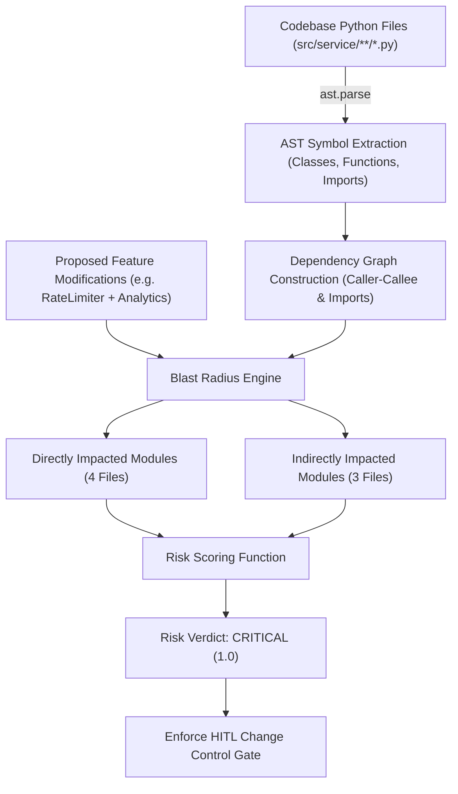

# AST Blast Radius Reasoning & Codebase Intelligence
### Deep Dive into Brownfield Code Analysis in AetherSDLC

---

## 1. Executive Overview
In brownfield software engineering (modifying an existing, running application), naive code edits often produce subtle, catastrophic regressions:
* Altering a data model or schema field breaks persistence queries.
* Modifying a service signature breaks upstream routers or middleware.
* Changing an internal helper introduces subtle circular imports.

Rather than relying on lexical pattern matching (`grep` or regex) or asking an LLM to guess what might break, **AetherSDLC implements true deterministic static analysis via Python's Abstract Syntax Tree (`ast` module)**.

---

## 2. How the Algorithm Operates (`src/agents/blast_radius_agent.py`)

The blast radius calculation follows a 4-phase deterministic pipeline:

### Phase 1: AST Parsing & Symbol Extraction
The agent parses every Python file under `src/service/` into an AST tree using Python's standard `ast` library. From each file, it extracts:
* **Classes**: e.g., `ShortURLRecord`, `ClickEventRecord`, `BaseURLRepository`, `SQLiteURLRepository`, `URLShortenerService`.
* **Functions & Methods**: e.g., `encode_base62()`, `resolve_url()`, `is_allowed()`, `shorten_url()`.
* **Import Statements**: `ast.Import` and `ast.ImportFrom` statements, mapping exact module bindings.

### Phase 2: Dependency Graph Construction
The engine maps bidirectional dependencies:
$$\text{Module } A \longrightarrow \text{Module } B \iff \text{Module } A \text{ imports symbols from } B$$

For the URL Shortener domain:
* `src/service/app.py` imports `src/service/routers/url.py`, `src/service/routers/analytics.py`, and `src/service/core/rate_limiter.py`.
* `src/service/routers/url.py` imports `src/service/models.py`, `src/service/service.py`, and `src/service/core/validator.py`.
* `src/service/routers/analytics.py` imports `src/service/models.py`, `src/service/service.py`, and `src/service/storage/base.py`.
* `src/service/service.py` imports `src/service/models.py`, `src/service/storage/base.py`, `src/service/core/encoder.py`, and `src/service/core/cache.py`.
* `src/service/storage/memory_sqlite.py` imports `src/service/models.py` and `src/service/storage/base.py`.

### Phase 3: Blast Radius Tracing
When a Brownfield request arrives (such as adding sliding-window rate limiting and device/referrer click analytics):
1. **Direct Impact Set ($D$)**:
   * `src/service/models.py`: Must add `DeviceStat`, `ReferrerStat`, and expand `ClickEventRecord`.
   * `src/service/storage/memory_sqlite.py`: Must alter database queries to aggregate clicks by device and referrer.
   * `src/service/routers/analytics.py`: Must expose device and referrer analytics endpoints.
   * `src/service/service.py`: Must orchestrate device parsing and rate limiting lookups.
   $$\mathbf{D = 4 \text{ modules}}$$

2. **Indirect Impact Set ($I$)**:
   Any module that imports symbols from $D$:
   * `src/service/app.py` (mounts routers)
   * `src/service/routers/url.py` (shares models)
   * `src/service/storage/base.py` (base repository contract)
   $$\mathbf{I = 3 \text{ modules}}$$

3. **Total Blast Radius**:
   $$\text{Total Affected} = |D| + |I| = 4 + 3 = 7 \text{ modules}$$

---

## 3. The Risk Scoring Formula

The risk score is computed as:
$$\text{RiskScore} = \min\left(1.0, \; \text{Base} (0.2) + \Delta_{\text{schema}} + \Delta_{\text{router}} + \Delta_{\text{breadth}}\right)$$

Where:
* $\Delta_{\text{schema}} = +0.4$ if data models (`models.py`) or database storage (`memory_sqlite.py`) are modified.
* $\Delta_{\text{router}} = +0.2$ if HTTP endpoints or application routers (`analytics.py`, `app.py`) are modified.
* $\Delta_{\text{breadth}} = +0.2$ if total impacted modules $\ge 3$.

### Calculated Score:
$$\text{RiskScore} = 0.2 + 0.4 + 0.2 + 0.2 = \mathbf{1.0 \; (\text{CRITICAL})}$$

### Enterprise Governance Implication:
In an enterprise financial-grade environment, any change scoring $\ge 0.8$ (`CRITICAL`) **cannot proceed autonomously**. The system automatically triggers an **HITL Change Control Gate** (`HITL-SCHEMA-01`), halting execution and displaying the exact proposed diff and impact radius for human architectural sign-off before a single line of code is applied!
